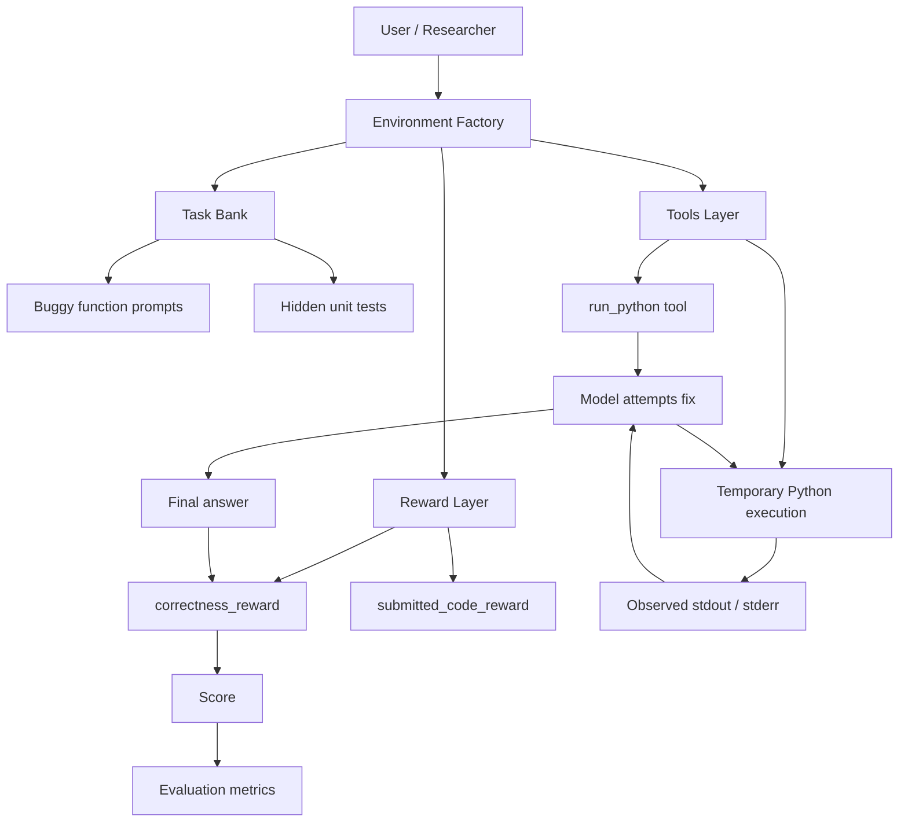

# RL Environments

[](https://www.python.org/)
[](https://github.com/PrimeIntellect-ai/verifiers)
[](LICENSE)

<div align="center">


  <h3>Verifiable reinforcement learning environments for agentic training.</h3>

  <p>
    <strong>RL Environments</strong> packages self-contained tasks with real, executable reward functions.
    Each environment is designed to train and evaluate agents using verifiable outcomes rather than brittle string similarity.
  </p>

</div>

---

## Why this project exists

Training agents with RL often fails when rewards are noisy, brittle, or easy to game. This project addresses that by building environments where the final score depends on actual behavior:

- run real code
- inspect real outcomes
- grade against concrete tests or execution results

This makes the reward signal more faithful to the task and much easier to reason about.

---

## Quick-start cards

<table>
  <tr>
    <td width="50%">
      <h3>🚀 Run locally</h3>
      <pre><code>cd environments/code_debugger
pip install -e .
vf-eval code-debugger -m qwen2.5:1.5b</code></pre>
      <p><strong>Fastest path</strong> to a working example.</p>
    </td>
    <td width="50%">
      <h3>🌐 Publish to the hub</h3>
      <pre><code>cd environments/code_debugger
prime env push</code></pre>
      <p><strong>Share</strong> your environment once it is ready.</p>
    </td>
  </tr>
  <tr>
    <td width="50%">
      <h3>📦 Use in Python</h3>
      <pre><code>import verifiers as vf

env = vf.load_environment("code-debugger", max_turns=6)</code></pre>
      <p>Integrate the environment into a training workflow.</p>
    </td>
    <td width="50%">
      <h3>🛠️ Build new environments</h3>
      <pre><code>environments/
└── my_environment/
    ├── my_environment.py
    ├── pyproject.toml
    └── README.md</code></pre>
      <p>Use the code-debugger package as a template.</p>
    </td>
  </tr>
</table>

---

## Live architecture overview



### Architecture notes

- The repository is organized as a collection of self-contained environment packages.
- Each environment owns:
  - a task bank
  - tool definitions
  - evaluation logic
  - package metadata
- The current project includes a working example environment: `code-debugger`.

---

## Project modules by business area

This repository is organized around practical RL training workflows. The current environment follows a “task + tool + reward” shape that can easily expand to broader operations-style domains.

| Area | Purpose | Current Status |
|------|---------|----------------|
| Shipments | Track, validate, and optimize delivery workflows | Template-ready |
| Inventory | Balance supply, demand, and stock movement | Template-ready |
| Routing | Optimize route selection under constraints | Template-ready |
| Forecasting | Predict demand and operational outcomes | Template-ready |
| IoT | Process sensor streams and operational signals | Template-ready |

The repo’s current example is more focused on code-debugging, which serves as a practical template for these domain areas:

- a model receives a task
- interacts with tools
- produces an answer
- is graded via verifiable execution outcomes

---

## Repository overview

```text
rl-environment/
├── README.md
├── .gitignore
├── LICENSE
├── environments/
│   └── code_debugger/
│       ├── README.md
│       ├── code_debugger.py
│       └── pyproject.toml
```

### Core environment

#### `environments/code_debugger`
This is the current working example environment. It includes:

- a set of buggy Python functions
- a tool that executes Python code in a subprocess
- hidden unit tests that verify correctness
- a reward function based on pass rate

The environment demonstrates:
- multi-turn tool use
- code execution as evaluation
- RL training grounded in actual output

---

## The current environment: code-debugger

The `code-debugger` environment trains an agent to fix bugs in Python functions using a code execution tool.

### What it does
The model is handed a broken function and a description of what it should do. It can call a Python execution tool multiple times to test hypotheses, then submits a final function body in a fenced Python code block.

### Why it is useful
This environment is useful because it:

- teaches tool use in a strongly grounded setting
- rewards actual correctness instead of surface similarity
- is easy to run locally
- is a good template for more complex domain-specific RL tasks

### Supported bug patterns
The example environment currently includes tasks covering:

- off-by-one errors
- mutable default arguments
- string manipulation mistakes
- recursive base-case errors
- deduplication order bugs
- binary-search boundary bugs

---

## Getting started

### Prerequisites

- Python 3.10+
- `uv` or `pip`
- optional: Ollama for local model inference

### Install

```bash
git clone https://github.com/Jasmine0987/rl-environment.git
cd rl-environment
```

### Run the example environment

```bash
cd environments/code_debugger
python -m venv venv
source venv/bin/activate
pip install -e .
pip install verifiers
```

Then evaluate locally:

```bash
vf-eval code-debugger -m qwen2.5:1.5b -b http://localhost:11434/v1 -k OPENAI_API_KEY
```

---

## Usage example

```python
import verifiers as vf

env = vf.load_environment("code-debugger", max_turns=6)
```

This loads the environment and prepares its dataset, tool interface, and reward logic.

---

## Reward design

The environment uses verifiable grading rather than text similarity.

```python
def correctness_reward(completion, info: dict, **kwargs) -> float:
    code = _extract_final_code(completion)
    if not code:
        return 0.0

    tests = info["tests"]
    script = code + "\n\n" + "\n".join(
        f"try:\n    {t}\n    print('PASS')\nexcept Exception as e:\n    print('FAIL:', e)"
        for t in tests
    )

    result = run_python(script)
    passed = result.count("PASS")
    return passed / len(tests) if tests else 0.0
```

This means:
- output is scored based on actual execution
- debugging ability matters
- rewards are tied to real correctness

---

## Project status

| Status | Description |
|--------|-------------|
| ✅ Current | `code-debugger` example environment works |
| ✅ Template-ready | Environment structure is reusable |
| 🚧 Extensible | Future domain environments can be added cleanly |

---

## Contributing

Contributions are welcome.

To add a new environment:
1. create a new package under `environments/`
2. include a `pyproject.toml`
3. implement the environment factory
4. add a reward model grounded in executable outcomes
5. document the task and evaluation flow

For questions or feature requests, open an issue on the repository.

---

## Support

- Repository: https://github.com/Jasmine0987/rl-environment
- Issues: https://github.com/Jasmine0987/rl-environment/issues
- Environments Hub: https://app.primeintel.ai

---

## License

This project is licensed under the MIT License. See the [LICENSE](LICENSE) file for details.

---

## 👤 Authors & Maintainers

| Role | Name | GitHub |
|------|------|--------|
| **Creator & Maintainer** | Jasmine | [@Jasmine0987](https://github.com/Jasmine0987) |
| **Framework** | Prime Intellect | [@PrimeIntellect-ai](https://github.com/PrimeIntellect-ai) |

---

<div align="center">

### 🚀 Ready to Get Started?

**[Run Locally](#getting-started)** • **[Build an Environment](#contributing)** • **[Publish to Hub](#support)**

**Questions?** [Open an issue](https://github.com/Jasmine0987/rl-environment/issues)

</div>
